# ha-cover-card

[](https://www.home-assistant.io/integrations/marketplace/)
[](https://github.com/juju35/ha-cover-card/actions/workflows/hacs.yml)
[](https://github.com/juju35/ha-cover-card/actions/workflows/validate.yml)
[](https://github.com/juju35/ha-cover-card/actions/workflows/lint.yml)
[](https://github.com/juju35/ha-cover-card/releases/latest)
[](https://github.com/juju35/ha-cover-card/blob/main/LICENSE)
[](https://buymeacoffee.com/julienstep9)

<p align="center">
  &nbsp;&nbsp;
  &nbsp;&nbsp;
  &nbsp;&nbsp;
  &nbsp;&nbsp;
  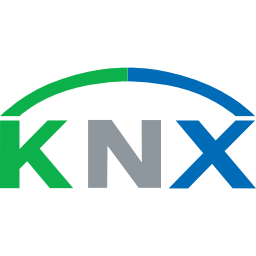&nbsp;&nbsp;
  &nbsp;&nbsp;
  &nbsp;&nbsp;
  &nbsp;&nbsp;
  &nbsp;&nbsp;
  
</p>

Lovelace cards for Home Assistant to control **covers of any integration**: roller shutters, venetian blinds, roller shades, curtains, awnings, garage doors, gates, doors, roof windows and dampers. Each cover is drawn as a little animated scene that follows its device class and position, and the picture itself is the position slider: drag it the way the cover opens (up for a shutter, down for an awning, sideways for curtains and a sliding gate).

The cards read the `cover` domain only, so they work with every integration that provides covers (Somfy, Shelly, Z-Wave, Zigbee, KNX, template covers…). What they show follows the features each cover reports: no position slider for a cover that cannot be set to a position, a tilt slider only for slats that tilt, no Stop button for a cover that cannot stop.

[](https://my.home-assistant.io/redirect/marketplace_repository/?owner=juju35&repository=ha-cover-card&category=plugin)

| Cover Card | Cover Mini Card |
|---|---|
| 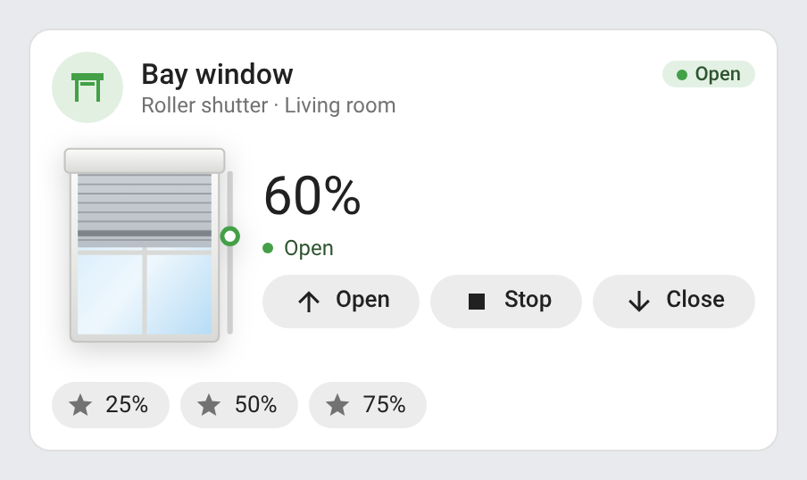 | 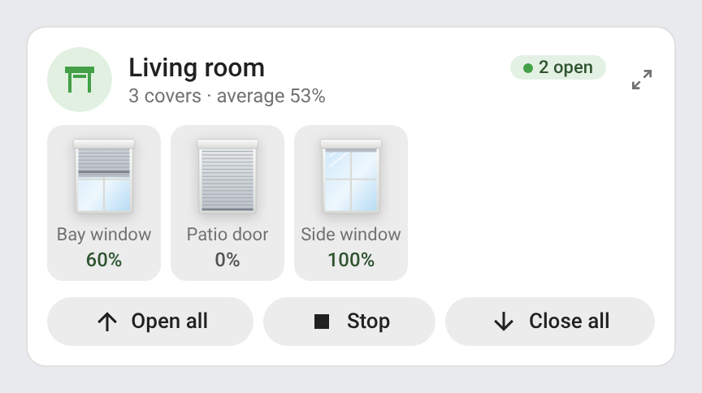 |
| 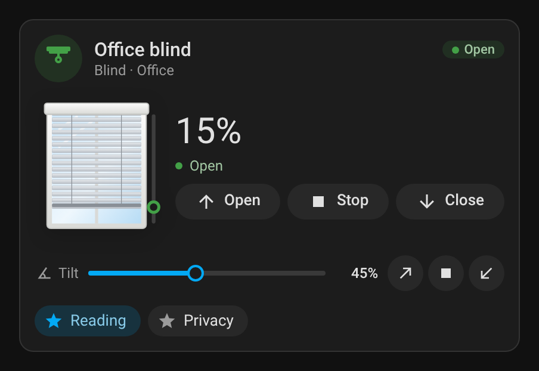 | 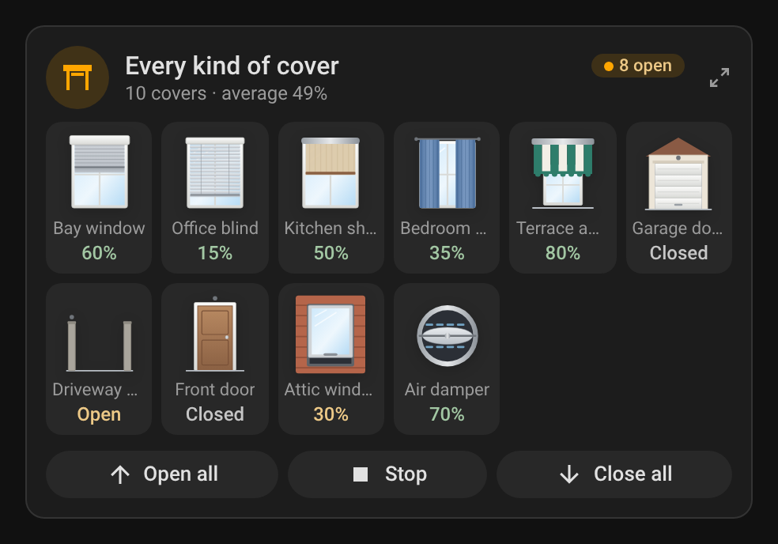 |

## Features

- Two cards: a full **Cover Card** (`custom:cover-card`) and a compact **Cover Mini Card** (`custom:cover-mini-card`)
- One cover, a list of covers, or **every cover of an area** (`area`), mixed freely
- A drawn scene per device class: roller shutter, venetian blind, roller shade, curtains, awning, garage door, sliding gate, door, roof window and damper (a cover without a device class is a roller shutter; `device_class` draws another one)
- **The picture is the position slider**: drag it (mouse, touch or pen) the way the cover moves (up for what rises, down for an awning that unrolls, sideways for curtains and a sliding gate, whose rail lies under the picture and leaves vertical swipes to the page) or use the arrow keys, Page Up / Down, Home and End; the position is sent once you let go, and the picture holds it until the cover reports its new state
- While a cover moves, its scene **animates its own way** (rolling slats, swaying folds, blinking warning lamp, flowing air…) and a mark on the rail shows where it is going
- **Tilt** slider and buttons for slats that tilt (venetian blinds, some shutters and awnings), shown only when the cover supports it
- Open / Stop / Close buttons for the features each cover supports; Open is disabled once fully open, Close once fully closed (unless the cover only assumes its state, as a radio motor that reports nothing back), and the button of the way the cover moves gets the accent color
- **Favorite positions**: one-tap buttons for a position, a tilt or both (`favorites`), per cover or for the whole group; the favorite reached is lit
- Several covers: **Open all / Stop / Close all** buttons for the covers that support them, and one foldable row per cover (folded rows unfold to the full detail, a click elsewhere folds them back)
- Confirmation before opening, closing or moving a garage door, a gate or a door, by its buttons, the group buttons, a favorite or its slider, in a popup at the top of the card; `confirm: true` asks for every cover, `confirm: false` never
- Header with an icon of the kind of cover in a tinted badge, colored with the state (blue while moving, green open, orange for an open garage door, gate, door or window, grey closed, red unavailable), a summary ("3 covers · average 53%") and a status chip on the title line
- Unavailable covers are greyed, their buttons and sliders disabled; a missing entity is reported in its row
- Detail button on the mini card (top right): it switches the mini card to the full card's content and back; a click anywhere outside the card brings the compact view back
- Click a position, a thumbnail or the status chip to open the Home Assistant more-info dialog
- Sections view: the full card takes 12 columns by default and at least 6, the mini card 6; narrow widths keep the icons of the buttons
- Keyboard and screen readers: sliders with their orientation, range and value, buttons with names, foldable rows that tell whether they are unfolded
- Visual editor in the dashboard UI for both cards (no YAML needed)
- Light and dark mode, `prefers-reduced-motion` honoured, English, French, German, Spanish, Serbian (Cyrillic and Latin), Italian, Dutch, European Portuguese, Polish, Romanian, Danish, Swedish, Bulgarian, Russian, Ukrainian, Hungarian, Slovak, Czech, Slovenian, Latvian and Greek
- Single file, no external dependency

## Supported integrations

Every integration that provides `cover` entities: the cards use only the cover services (`open_cover`, `close_cover`, `stop_cover`, `set_cover_position`, the tilt services) and the standard attributes (`current_position`, `current_tilt_position`, `supported_features`, `device_class`). For example:

| Integration | Typical covers |
|---|---|
|  [Overkiz](https://www.home-assistant.io/integrations/overkiz/) (Somfy TaHoma),  [Somfy MyLink](https://www.home-assistant.io/integrations/somfy_mylink/) | Roller shutters, awnings, blinds, garage doors, gates |
|  [Shelly](https://www.home-assistant.io/integrations/shelly/) | Roller shutters and blinds on Shelly 2PM / Plus 2PM (position and tilt) |
|  [Z-Wave](https://www.home-assistant.io/integrations/zwave_js/),  [ZHA](https://www.home-assistant.io/integrations/zha/), [Zigbee2MQTT](https://www.zigbee2mqtt.io/) /  [MQTT](https://www.home-assistant.io/integrations/cover.mqtt/) | Shutter and blind modules, curtain motors, garage door openers |
|  [KNX](https://www.home-assistant.io/integrations/knx/),  [Velux](https://www.home-assistant.io/integrations/velux/),  [Motion Blinds](https://www.home-assistant.io/integrations/motion_blinds/),  [IKEA / Matter](https://www.home-assistant.io/integrations/matter/) | Shutters, roof windows, blinds and shades |
|  [Tuya](https://www.home-assistant.io/integrations/tuya/),  [SwitchBot](https://www.home-assistant.io/integrations/switchbot/) | Curtain robots, blinds, gate and garage openers |
| [Template](https://www.home-assistant.io/integrations/cover.template/), [Group](https://www.home-assistant.io/integrations/group/) | Any cover you build, cover groups |

The picture follows the cover's `device_class`; set one in **Settings → Entities → (the cover) → Show as**, or draw another picture with the `device_class` option of the card.

## Prerequisites

Home Assistant 2024.8 or later.

## Installation

### Via the Marketplace (recommended)

Click the button below to add the repository directly:

[](https://my.home-assistant.io/redirect/marketplace_repository/?owner=juju35&repository=ha-cover-card&category=plugin)

Then click **Install**, and reload your browser when the Marketplace asks you to. The resource is `/local/community/ha-cover-card/cover-card.js`.

Or manually:

1. Open **Settings → Marketplace → Add from link** (top right; this needs a GitHub account connected)
2. Add `https://github.com/juju35/ha-cover-card` — Type: **Dashboard**
3. Open **Cover Card** and click **Install**
4. Clear your browser cache and refresh

### Manual

1. Download `cover-card.js` and the `cover-card.i18n.*.js` translation files from the [latest release](https://github.com/juju35/ha-cover-card/releases/latest)
2. Copy them all to `/config/www/` (without the translation files, the cards show in English)
3. Go to **Settings → Dashboards → ⋮ → Resources** → Add resource:
   - URL: `/local/cover-card.js`
   - Type: **JavaScript Module**
4. Clear your browser cache and refresh

## Configuration

### Card types

| Card | Type |
|---|---|
| Cover Card | `custom:cover-card` |
| Cover Mini Card | `custom:cover-mini-card` |

### Visual editor

Edit a dashboard, click **Add card** and search for **Cover Card** or **Cover Mini Card**. The full card starts with your first cover, the mini card with the area that has the most covers. Pick covers and/or an area, an optional title, the picture, favorite positions (pick or type them), the parts to show, when to ask for confirmation and the language. The preview updates live, and options left at their default are kept out of the generated YAML. Per-cover options (`name`, `device_class`, `favorites` of one cover) are set in YAML; the editor keeps them.

### Minimal

```yaml
type: custom:cover-card
entity: cover.living_room_bay_window
```

```yaml
type: custom:cover-mini-card
area: living_room
```

### Full options

```yaml
type: custom:cover-card
title: Ground floor
area: living_room
entities:
  - cover.kitchen_shade
  - entity: cover.office_blind
    name: Office
    favorites:
      - name: Reading
        position: 15
        tilt: 45
      - name: Privacy
        position: 0
        tilt: 10
  - entity: cover.garage_door
    device_class: garage
favorites:
  - 0
  - 50
  - 100
show_controls: true
show_group_controls: true
show_tilt: true
show_favorites: true
expanded: false
confirm: true
language: fr
```

```yaml
type: custom:cover-mini-card
title: Every shutter
entities:
  - cover.living_room_bay_window
  - cover.living_room_patio_door
  - cover.bedroom_curtains
favorites: [25, 75]
zoom: true
```

### Options reference

| Option | Card | Default | Description |
|---|---|---|---|
| `entity` | both | — | One cover |
| `entities` | both | — | Covers: entity ids, or objects with `entity` and the per-cover options below |
| `area` | both | — | An area (its id or its name): every cover of the area is added, after `entity` and `entities` (hidden entities left out) |
| `title` | both | Cover name, area name or "Covers" | Card title |
| `show_title` | both | `true` | Show the title in the header |
| `show_subtitle` | both | `true` | Show the subtitle (kind of cover and area, or the number of covers and their average position) |
| `device_class` | both | Device class of each cover | Picture to draw for every cover: `shutter`, `blind`, `shade`, `curtain`, `awning`, `garage`, `gate`, `door`, `window` or `damper` |
| `favorites` | both | — | Favorite positions: numbers (a position in %) or objects with `name`, `position` and/or `tilt`. With one cover they are its favorites; with several, they move every cover that can take them |
| `show_controls` | both | `true` | Open / Stop / Close buttons (and the tilt buttons) |
| `show_group_controls` | full | `true` | Open all / Stop / Close all buttons above the rows of several covers |
| `show_tilt` | both | `true` | Tilt slider and buttons, for the covers that support tilt |
| `show_favorites` | both | `true` | Favorite position buttons |
| `expanded` | both | `false` | Unfold every row of a card of several covers (otherwise click a row to unfold it; a click elsewhere folds it back) |
| `confirm` | both | Garage doors, gates and doors | Ask in a popup before opening, closing or moving a cover (buttons, group buttons, favorites and slider; Stop never asks). Unset, it asks when a garage door, a gate or a door is among the covers moved; `true` asks for every cover, `false` never |
| `zoom` | mini | `true` | Detail button at the top right of the mini card: it shows the full card's content (with the same options) and switches back to the compact view; a click outside the card also brings the compact view back. `false` removes the button |
| `language` | both | Auto | Force language: `fr`, `en`, `de`, `es`, `sr`, `sr-Latn`, `it`, `nl`, `pt`, `pl`, `ro`, `da`, `sv`, `bg`, `ru`, `uk`, `hu`, `sk`, `cs`, `sl`, `lv` or `el` (auto-detects from Home Assistant) |

Per-cover options, in an object of `entities`:

| Option | Description |
|---|---|
| `entity` | The cover (required) |
| `name` | Name shown instead of the friendly name |
| `device_class` | Picture of this cover (same values as above) |
| `favorites` | Favorite positions of this cover (same form as above), shown in its detail |

## Screenshots

### Cover Card

One cover: its scene and position slider, the state, the buttons and its favorite positions (here `favorites: [25, 50, 75]`):

| Light | Dark |
|---|---|
|  | 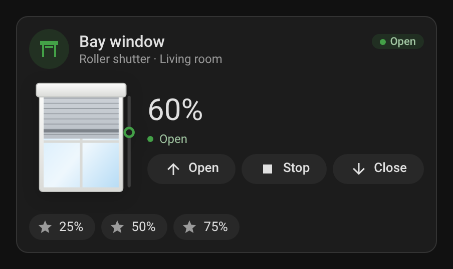 |

A venetian blind adds its tilt slider and buttons; favorites can set a position and a tilt together, and the one reached is lit:

| Light | Dark |
|---|---|
| 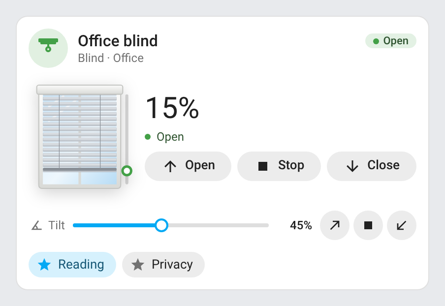 |  |

Every cover of an area (`area: living_room`): Open all / Stop / Close all, group favorites, and a foldable row per cover, the first one unfolded here:

| Light | Dark |
|---|---|
| 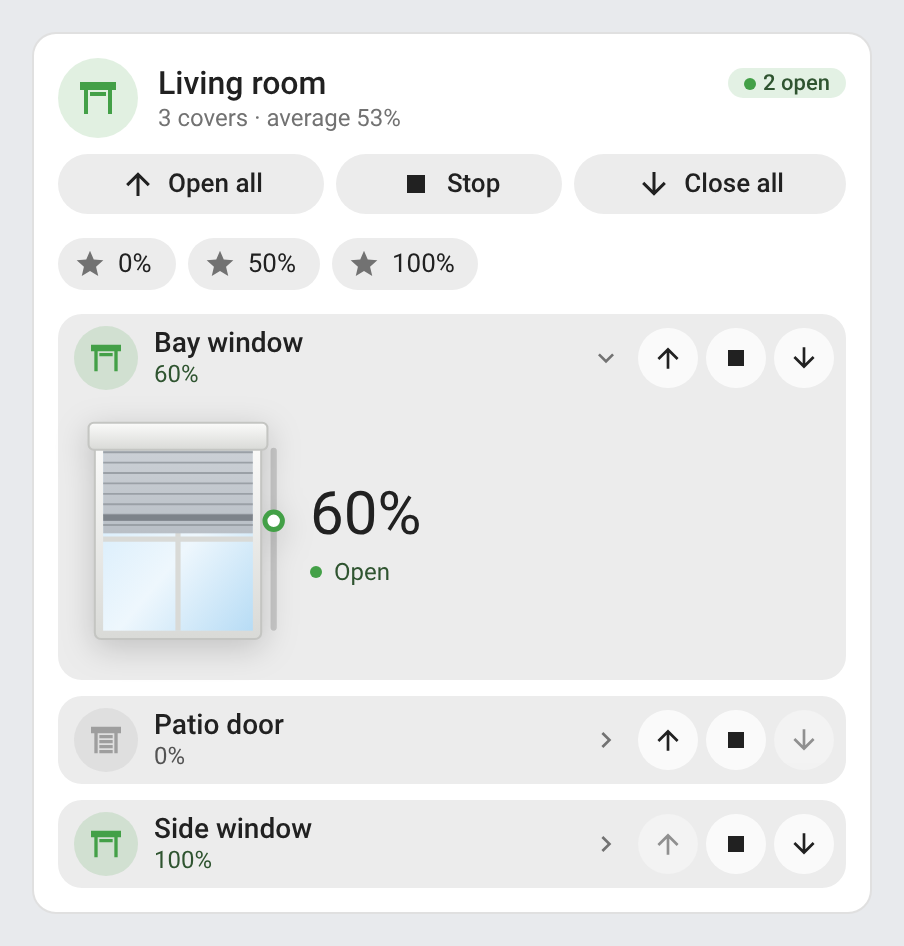 | 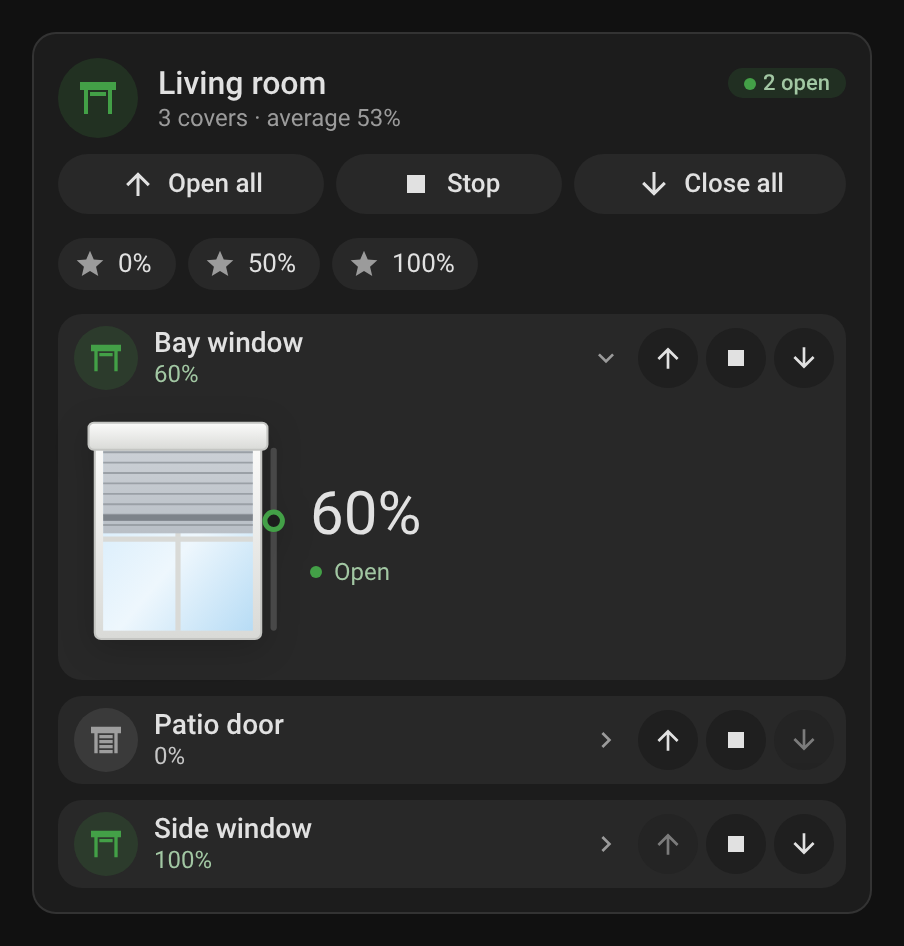 |

A garage door, a gate or a door asks before it opens or closes, in a popup at the top of the card (here a garage door, which reports no position: its state is written in big):

| Light | Dark |
|---|---|
| 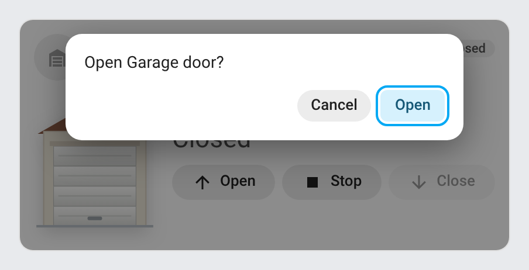 | 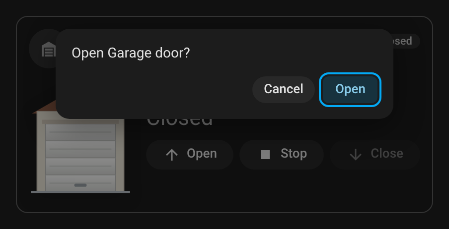 |

An unavailable cover: red chip, greyed picture, disabled buttons and slider:

| Light | Dark |
|---|---|
| 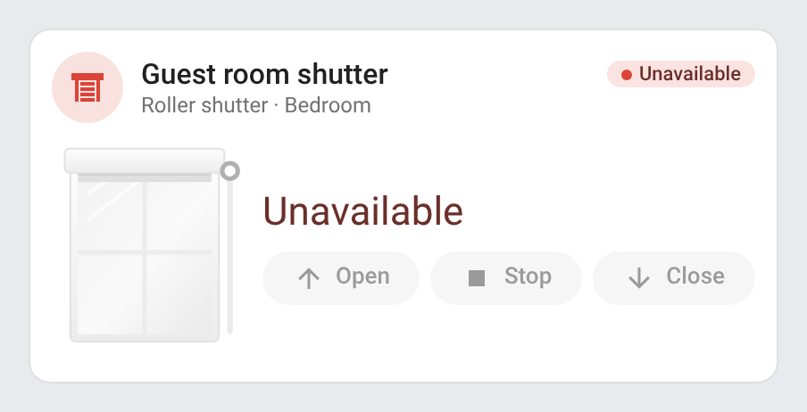 | 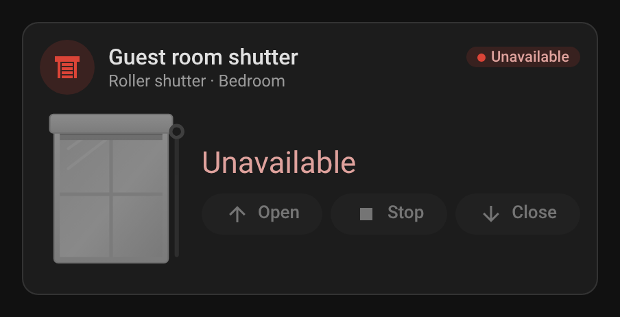 |

### Cover Mini Card

A group at a glance: a thumbnail per cover with its position or state, and the buttons for all of them:

| Light | Dark |
|---|---|
|  | 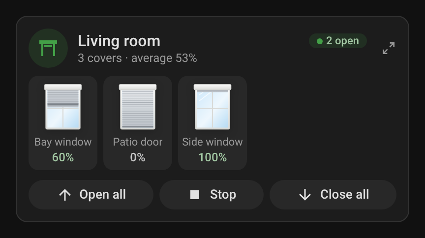 |

Every kind of cover, each drawn with its own scene:

| Light | Dark |
|---|---|
| 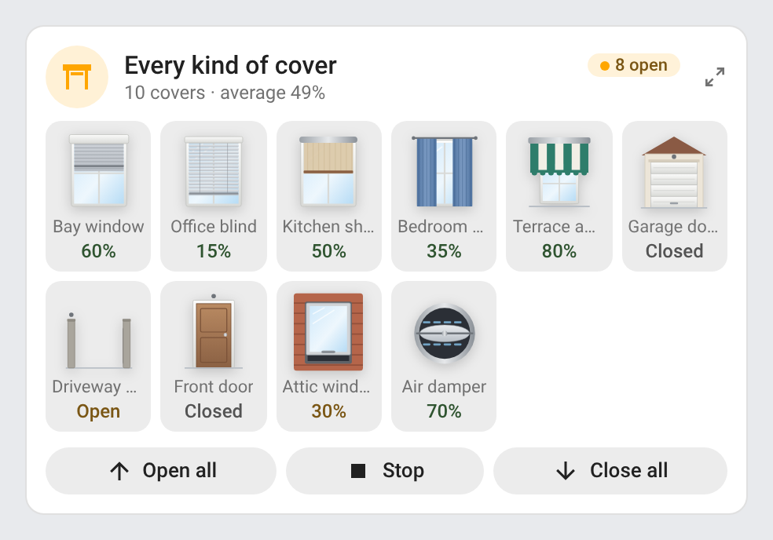 |  |

The detail button switches the mini card to the full card (a click outside the card brings the compact view back):

| Light | Dark |
|---|---|
| 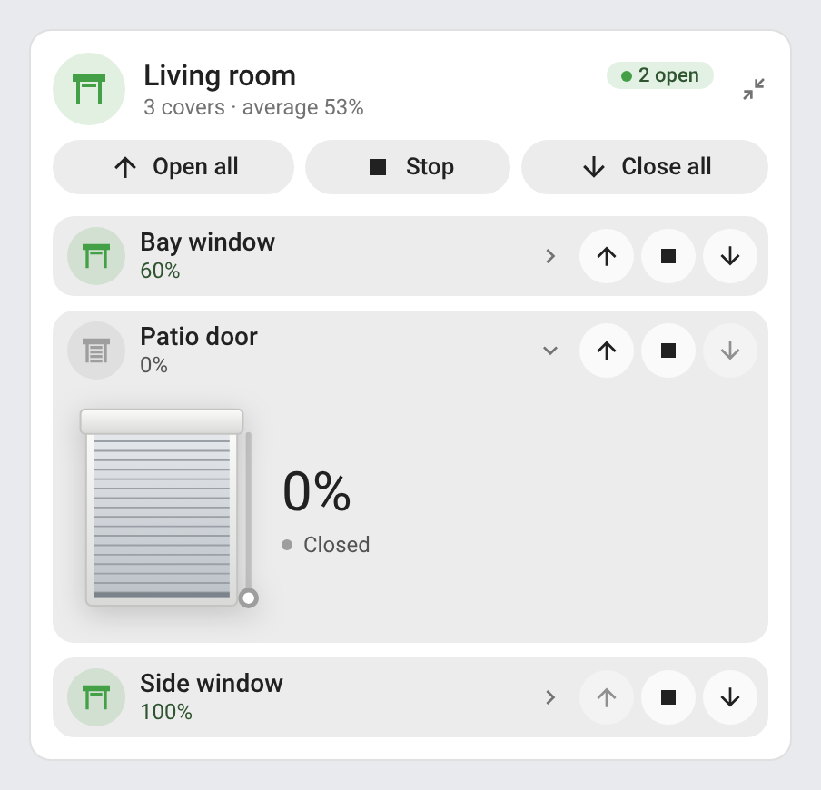 | 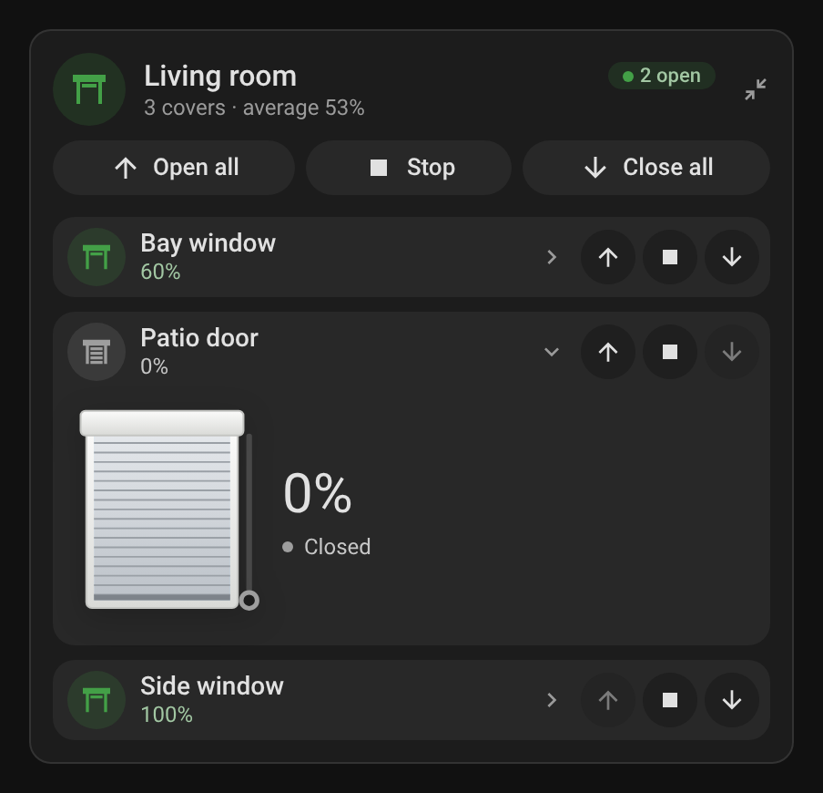 |

### Animations

Each kind of cover moves its own way while it opens or closes, and settles back to a still picture once stopped. Every animation honours `prefers-reduced-motion`.

While a roller shutter closes, its aluminium slats roll down out of the box and the edge steps toward the sill; the knob of the slider pulses in the moving color.

| Light | Dark |
|---|---|
| 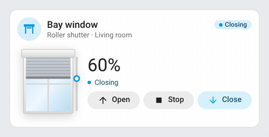 | 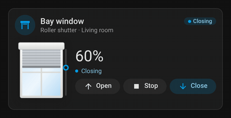 |

Opening, the slats roll the other way and the edge climbs back into the box.

| Light | Dark |
|---|---|
| 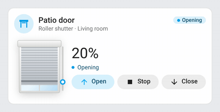 | 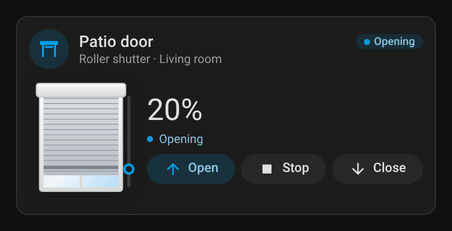 |

A venetian blind lifts its tilted slats with the bottom rail; the slats keep the angle of the tilt.

| Light | Dark |
|---|---|
| 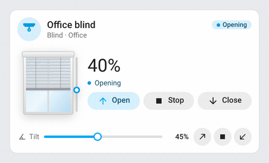 | 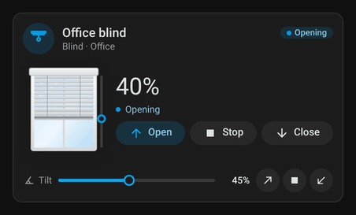 |

A roller shade unrolls its linen fabric; the weighted bottom bar sways a little as it goes.

| Light | Dark |
|---|---|
| 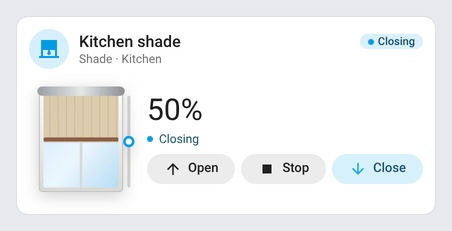 | 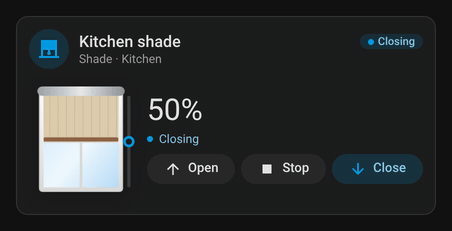 |

Curtains draw aside on their rod, their folds swaying as they move.

| Light | Dark |
|---|---|
| 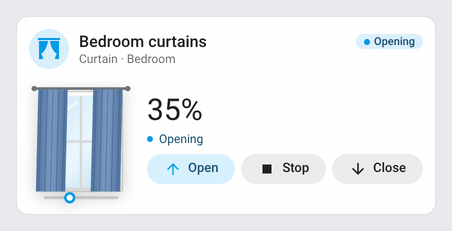 | 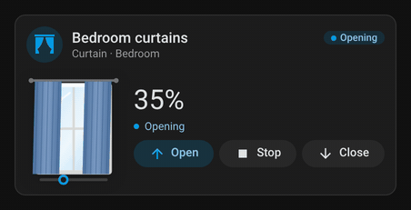 |

An awning unrolls its striped fabric over the window, the scalloped valance fluttering.

| Light | Dark |
|---|---|
| 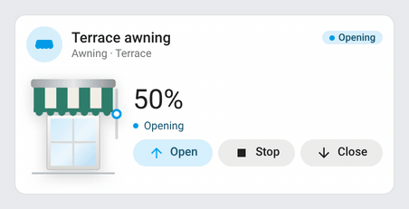 | 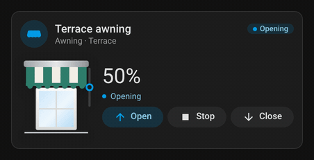 |

A garage door rises section by section under the roof, while the warning lamp above it blinks.

| Light | Dark |
|---|---|
| 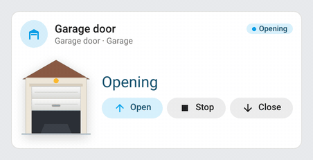 | 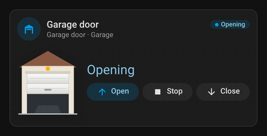 |

A sliding gate comes out from behind its pillar, warning lamp blinking.

| Light | Dark |
|---|---|
| 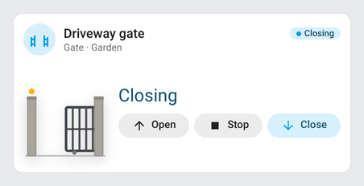 | 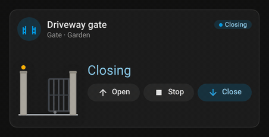 |

A motorized door swings in, under its blinking lamp.

| Light | Dark |
|---|---|
| 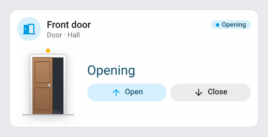 | 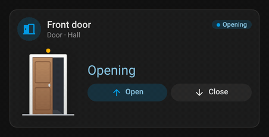 |

A roof window tilts its sash out of the tiles, showing the opening beneath.

| Light | Dark |
|---|---|
| 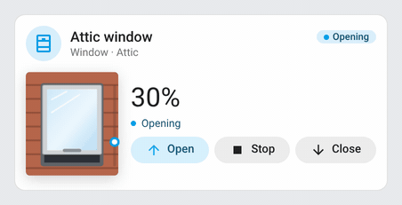 | 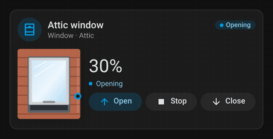 |

A damper turns its blade edge-on and the air starts flowing through the duct.

| Light | Dark |
|---|---|
| 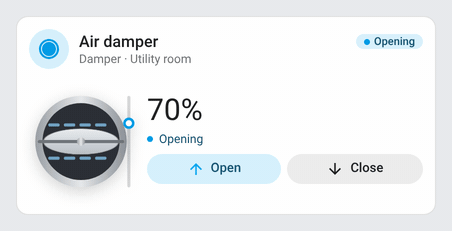 | 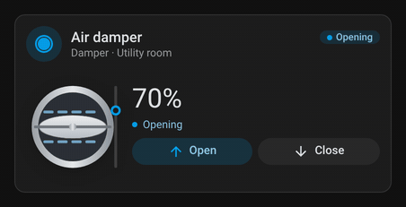 |

## How it works

- **Position**: 0 % is closed and 100 % open, as in Home Assistant. The slider follows the moving edge of the picture: the top is open for what rises (shutter, blind, shade, garage door, and by convention door, roof window and damper), the bottom for an awning, the right for curtains and a sliding gate. A cover without `current_position` is drawn fully open or closed by its state, and half-way while it moves.
- **Features**: buttons, sliders and favorites follow `supported_features` (open, close, set position, stop, and the four tilt features). A cover without `supported_features` (an old template cover) gets open, close and stop, plus position and tilt when it reports them.
- **Colors**: moving is blue, open is green (orange for a garage door, gate, door or window), closed is grey and unavailable red; the header and the summary take the state of the group.
- **Redraws**: the card is redrawn only when one of its covers changes, never while a slider is held.

## Development

```bash
npm install
npm run build        # bundles src/cover-card.js into dist/cover-card.js and its translation files
npm run check        # builds and checks the card (run in CI)
npm test             # unit tests (and the browser tests when Chromium is installed)
npm run screenshots  # renders the cards (and one GIF per animation, needs ffmpeg) with mock data into screenshots/
```

`dist/` is not committed: `npm run build` creates it locally, CI builds it on every push, and the release workflow attaches the built files to the release, which is where the Marketplace installs them from.

### Releasing

1. Bump `version` in `package.json` (and `package-lock.json`, with `npm install`)
2. Add a `## <version>` section at the top of [CHANGELOG.md](https://github.com/juju35/ha-cover-card/blob/main/CHANGELOG.md)
3. Push to `main`: the **Release** workflow builds the card, creates the tag and the GitHub release with the changelog section as notes, and attaches `cover-card.js` and its translation files

## Translations

The cards auto-detect the language from your Home Assistant settings. English is in the card file; every other language is a small file next to it, loaded only when needed. Currently supported:

| Language | Code |
|---|---|
| English | `en` |
| Français | `fr` |
| Deutsch | `de` |
| Español | `es` |
| Српски | `sr` |
| Srpski (latinica) | `sr-Latn` |
| Italiano | `it` |
| Nederlands | `nl` |
| Português (European; also used for `pt-BR`) | `pt` |
| Polski | `pl` |
| Română | `ro` |
| Dansk | `da` |
| Svenska | `sv` |
| Български | `bg` |
| Русский | `ru` |
| Українська | `uk` |
| Magyar | `hu` |
| Slovenčina | `sk` |
| Čeština | `cs` |
| Slovenščina | `sl` |
| Latviešu | `lv` |
| Ελληνικά | `el` |

Contributions for additional languages are welcome!

## Credits

Icons from [Material Design Icons](https://pictogrammers.com/library/mdi/) (Apache License 2.0). The pictures of the covers are drawn by the card.

## License

[MIT](https://github.com/juju35/ha-cover-card/blob/main/LICENSE)

## Support

If you find this project useful, you can support its development:

<a href="https://buymeacoffee.com/julienstep9"></a>
